# Interview Prep: DTC Bus Tracker

A question bank for interviews about this project, built from the actual code in this repository. Every question has two answers:

- **Easy answer**: what to say in 20–30 seconds.
- **Detailed answer**: what to say when the interviewer asks a follow-up, with the class names to quote.

The diagrams are Mermaid and render on GitHub.

**Contents**

1. [Your 60-second pitch](#1-your-60-second-pitch)
2. [Architecture questions](#2-architecture-questions)
3. [System design questions](#3-system-design-questions)
4. [Database questions](#4-database-questions)
5. [Backend (Java / Spring Boot) questions](#5-backend-java--spring-boot-questions)
6. [Concurrency and ticketing questions](#6-concurrency-and-ticketing-questions)
7. [Real-time (WebSocket / polling) questions](#7-real-time-websocket--polling-questions)
8. [Caching and performance questions](#8-caching-and-performance-questions)
9. [Security questions](#9-security-questions)
10. [Algorithms and geospatial questions](#10-algorithms-and-geospatial-questions)
11. [Frontend questions](#11-frontend-questions)
12. [DevOps, deployment and testing questions](#12-devops-deployment-and-testing-questions)
13. [Weaknesses and "what would you improve?"](#13-weaknesses-and-what-would-you-improve)
14. [Behavioural questions about the project](#14-behavioural-questions-about-the-project)
15. [Rapid-fire revision sheet](#15-rapid-fire-revision-sheet)

---

## 1. Your 60-second pitch

> "I built a live bus tracker for Delhi Transport Corporation buses. The backend is Spring Boot 4 on Java 21. Every 4 seconds it polls Delhi's open GTFS-Realtime feed, a protobuf file with the GPS position of every bus. It uses ETags, so an unchanged feed costs one empty 304 response. Latest positions go to Redis, history goes to PostgreSQL, and updates are pushed to browsers over STOMP WebSockets. The React and Leaflet frontend shows buses on a map, arrival times at a bus stand, routes between two stands, and walking directions.
>
> The hard part was the data. The official static timetable is from 2024 and most live buses no longer drive the route their ID says. So I wrote a `RouteLearner` that learns the real route of each bus number from its GPS traces and uses the recorded travel times to estimate arrivals.
>
> There's also a seat-ticketing demo for conductors. It sells seats per route segment and uses pessimistic row locks so two sales can't take the same seat. It's deployed on Render with Docker, has CI on GitHub Actions, and I load-tested it: p50 latency for the main map endpoint dropped from 375 ms to 44 ms after I added a per-snapshot cache with pre-gzipped responses."

**Keywords to drop:** GTFS / GTFS-Realtime, protobuf, ETag / 304, Redis, PostgreSQL, STOMP over SockJS, pessimistic locking, idempotency key, JWT, spatial grid index, snapshot cache, gzip, Docker multi-stage build, CI.

---

## 2. Architecture questions

### Q2.1 Walk me through the architecture.

**Easy answer:** There are three parts: a React app, a Spring Boot API, and two data stores. The API pulls bus GPS from Delhi's feed every 4 seconds, keeps the latest position per bus in Redis and the history in Postgres, and pushes updates to browsers over WebSocket. Rider screens are served by REST endpoints that read an in-memory index of the timetable.

**Detailed answer:**

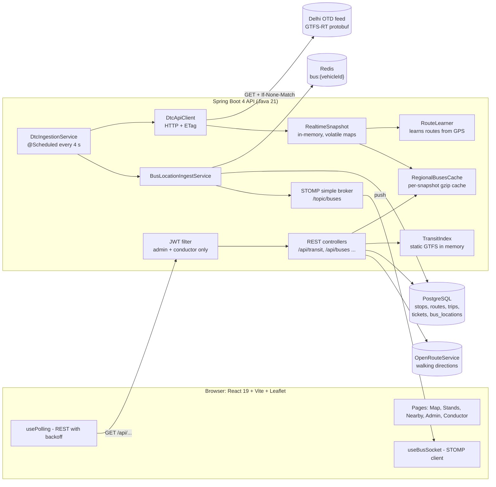

| Layer | Technology | Why |
|---|---|---|
| Frontend | React 19, Vite, Leaflet, STOMP.js and SockJS | Single-page app with maps and live updates |
| API | Spring Boot 4, Java 21 | REST, WebSocket, scheduling, security and JPA in one framework |
| Hot data | Redis | Latest position per bus: fast key/value, overwritten every poll |
| Durable data | PostgreSQL (H2 in demo mode) | Relational data: stops, routes, trips, tickets, history |
| In-memory | `TransitIndex`, `RealtimeSnapshot` | The whole timetable fits in about 60 MB, so no per-request DB scans |
| External | Delhi OTD GTFS-RT, OpenRouteService | Live GPS and walking routes |

### Q2.2 Why a modular monolith and not microservices?

**Easy answer:** It's one team, one deployable and a small free-tier server. Microservices would add network hops, deployment complexity and distributed-transaction problems without any benefit at this scale.

**Detailed answer:** The code is still split by responsibility. `live/` holds the rider transit engine, `controller/` and `service/` the legacy REST API and ticketing, and `security/` the auth. Interfaces mark the seams. `BusLocationPublisher` is an interface, and today `DirectBusLocationPublisher` writes straight to Redis. Kafka could later go behind the same interface without touching callers. `BusLocationStore` has a Redis implementation (`@Profile("!demo")`) and an in-memory one for demo mode. If the ingestion part ever needed to scale on its own, it is the first thing I would split out, because it is already isolated behind the publisher interface.

### Q2.3 What happens from the moment a bus moves to the moment a user sees it?

**Easy answer:** The bus GPS reports to Delhi's server. My scheduler polls that feed, filters and de-duplicates the positions, saves them to Redis and Postgres, and broadcasts them on a WebSocket topic. The browser batches the messages and redraws the map every 250 ms.

**Detailed answer:**

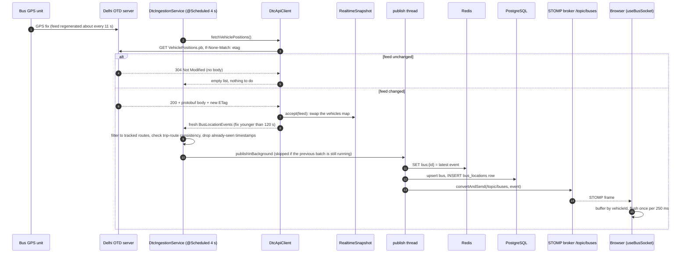

Numbers worth knowing: about 20 s of a fix's age happens before Delhi publishes it, which I can't change. From the server to the browser tab took p50 0.6 s after my optimisations.

### Q2.4 Why both Redis and PostgreSQL?

**Easy answer:** They have different jobs. Redis holds only the latest position of each bus, overwritten every few seconds, and serves fast reads. Postgres holds data that must survive restarts and be queried relationally: tickets, timetable and 24 hours of history.

**Detailed answer:** The latest position is a hot key/value entry that is constantly overwritten: one key per bus (`bus:{vehicleId}`), thousands of writes a minute, and no need for joins or durability. If Redis loses it, the next poll refills it in 4 seconds. History (`bus_locations`) is append-only and time-ordered, and it is queried by `(bus_id, recorded_at)` for Journey Replay. Tickets need ACID transactions and row locks. Putting the hot writes in Postgres would create bloat and vacuum pressure. Putting tickets in Redis would mean giving up transactions. In demo mode both are swapped out: H2 and `InMemoryBusLocationStore`, chosen by Spring profiles.

### Q2.5 Why keep the timetable in memory (`TransitIndex`) instead of querying the database?

**Easy answer:** The whole Delhi timetable is static and fits in about 60 MB. Loading it once at startup into hash maps gives O(1) lookups with no database round trips on every request.

**Detailed answer:** `TransitIndex` loads `GTFS.zip` at startup into maps: `stops`, `routes`, `trips`, `shapes`, `routesAtStop`, plus a spatial grid for nearest-stop queries. Stop visits are stored in packed arrays (`PackedVisits`, `PackedPoints`) instead of millions of small objects, which cut retained heap from 71 MB to 58 MB and load time from 12.0 s to 10.3 s. The trade-off is that updating the timetable requires a restart and memory grows with the size of the feed. That's fine because the feed changes rarely. Ask a follow-up about "how would you hot-reload it?": build a new index in the background, then swap a `volatile` reference atomically.

---

## 3. System design questions

### Q3.1 Design a real-time bus tracking system for a whole city (the classic interview question).

**Easy answer:** GPS devices send positions to an ingestion layer that puts them on a queue. Stream processors update a "latest position" store (Redis, sharded by bus ID) and append to a time-series history store. Riders get updates over WebSockets, fanned out through a pub/sub layer, and ETAs come from a service that combines live positions with historical travel times.

**Detailed answer.** Use this structure for any "design X" question:

**1. Requirements**

| Functional | Non-functional |
|---|---|
| Show live bus positions on a map | Freshness: under 5 s from ingest to screen |
| Arrival times at a stop | High read-to-write ratio: many riders, few buses |
| Search routes, plan trips | Available: stale data beats no data |
| Admin: fleet health | Scales with buses × riders |

**2. Estimates (Delhi)**

- About 7,000 buses × 1 update every 10 s ≈ **700 writes/s**. Small.
- 200,000 concurrent riders polling every 10 s ≈ **20,000 reads/s**. This is the real load.
- One position ≈ 100 bytes, so 7,000 × 8,640 updates/day × 100 B ≈ **6 GB/day** of history. Hence the retention policy and partitioning.

**3. High-level design**

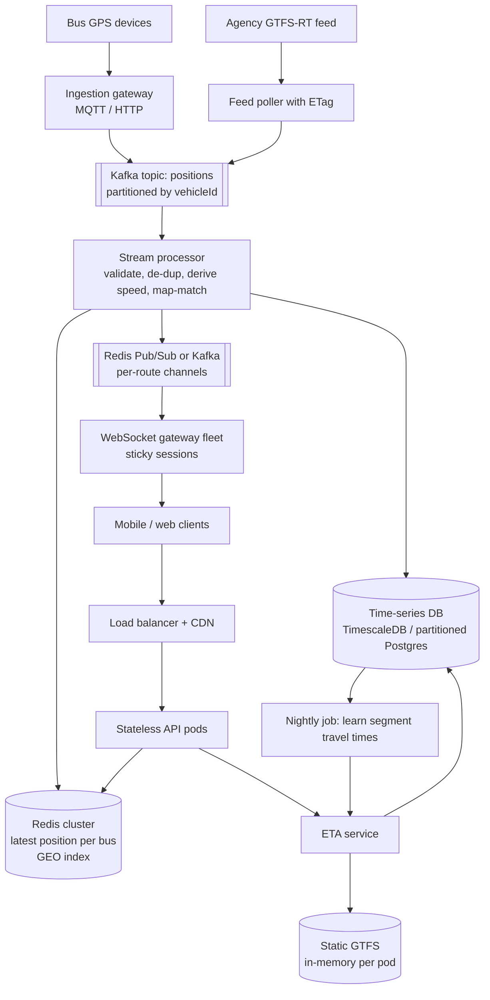

**4. Deep dives**

- **Ingestion:** partition by `vehicleId` so one bus's events stay in order.
- **Fan-out:** don't send all buses to everyone. Make a channel per route or per map tile, so a client subscribes to `/topic/route.534` or `/topic/tile.2864.7712`.
- **Read scaling:** cache the computed answer per feed snapshot. All clients asking the same thing between two updates share one computation. This repo does that in `RegionalBusesCache`.
- **ETA:** use live TripUpdates if present, then historical segment times, then remaining distance ÷ current speed (this repo's order).
- **Failure:** if the feed is down, serve the last snapshot marked stale with a warning. Never invent positions.

**5. How this repo maps to that design (say this):** "My project is the single-node version of this. The poller is `DtcIngestionService`, the latest store is Redis, history is `bus_locations` in Postgres with 24-hour retention, fan-out is Spring's in-memory STOMP broker, and the snapshot cache is `RegionalBusesCache`. To scale it I'd add Kafka between the poller and processors, a broker relay for STOMP, and per-route topics."

### Q3.2 How would you scale this app to 10× or 100× users?

**Easy answer:** The API is stateless for riders, so I'd run several instances behind a load balancer. Then I'd move the three in-process pieces that break with more than one instance (the STOMP broker, the login rate limiter and the scheduler) to shared infrastructure, and put a CDN in front of cacheable responses.

**Detailed answer:**

| Component today | Problem with N instances | Fix |
|---|---|---|
| `enableSimpleBroker("/topic")`, in memory | A client on instance B never sees events published on instance A | `enableStompBrokerRelay` to RabbitMQ/ActiveMQ, or Redis Pub/Sub |
| `@Scheduled` poller in every instance | N instances poll the feed N times and write duplicates | Leader election (ShedLock, a Redis lock) or a separate ingestion worker |
| `LoginAttemptLimiter`, in-memory map | Attacker spreads guesses across instances | Redis `INCR` + `EXPIRE` per IP |
| `RouteLearner` file `data/learned-routes.txt` | Each instance learns separately; file lost on redeploy | Store learned routes in Postgres or object storage |
| `RedisBusLocationStore.findAll()` uses `KEYS bus:*` | `KEYS` is O(N) and blocks Redis | One hash `HSET buses {id} {json}` + `HGETALL`, or `SCAN` |
| `bus_locations` single table | Large table, slow deletes | Partition by day, drop old partitions |

Read path: `/buses/regional` answers already carry an ETag and are pre-gzipped, so a CDN or reverse proxy could cache them for the 5 s window. For 100×, add Kafka and split ingestion from serving (Q3.1).

### Q3.3 Polling vs. WebSocket vs. Server-Sent Events: which did you use and why?

**Easy answer:** Both. WebSocket (STOMP) pushes raw bus positions. Polling serves computed views like stand arrivals, because those are expensive and change only when the feed changes, so the client polls right after the next expected snapshot.

**Detailed answer:**

| | Polling | WebSocket | SSE |
|---|---|---|---|
| Direction | Client pulls | Both directions | Server to client |
| Cost per client | One request per interval | One open connection | One open connection |
| Caching / CDN | Easy (ETag, gzip) | No | Hard |
| Reconnect | Built in | Need logic (STOMP `reconnectDelay: 4000`) | Built into the browser |
| Used here for | Stand arrivals, regional map, admin | `/topic/buses` raw positions | Not used |

A clever detail: the server sends an `X-Next-Update-In` header predicting when the next feed snapshot lands, and the client's `usePolling` uses `nextDelay` to poll just after it. That makes polling nearly as fresh as push without wasting requests. SSE would also have worked for the one-way position stream. I used STOMP because Spring has first-class support and topic subscriptions.

### Q3.4 How do you compute ETA (estimated time of arrival)?

**Easy answer:** In order of preference: the official prediction from the agency if present; otherwise how long buses on this route recently took for the same stretch; otherwise remaining distance along the route divided by the bus's current speed; and if the bus is stopped, an assumed 17 km/h.

**Detailed answer:**

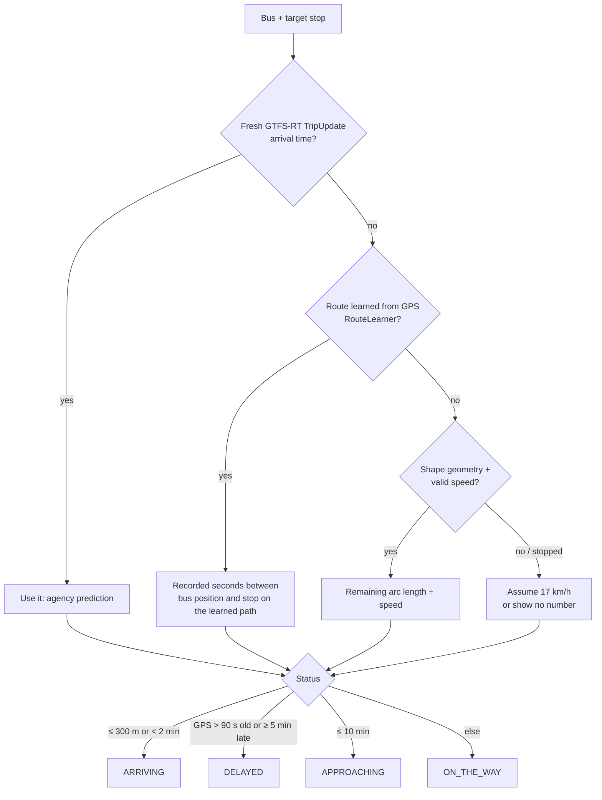

Key points: project the bus onto the route polyline to get the distance **along the road**, not straight-line distance. Reject fixes more than 100 m off the route, and reject stops the bus has already passed. The feed often reports speed 0, so speed is derived from two consecutive positions at least 3–5 s apart and capped at 120 km/h (`BusLocationIngestService.deriveSpeedFromMovement`).

### Q3.5 Design the "find a route between two bus stands" feature.

**Easy answer:** Pre-index every route's ordered stop sequence and a map from stop to routes. For a query, take every route that calls at the pick-up stand and check that the destination stand comes **later** in the same sequence. If there are fewer than 3 direct routes, look for one-change journeys.

**Detailed answer (`StandRouteService`):**

1. **Stands:** stops with the same normalised name within 300 m are one stand (`Sector`/`Sec`, `Kashmiri`/`Kashmere` unified).
2. **Index:** `pattern = distinct stop sequence of a route_id`; `stop → patterns`. Built in one pass over trips.
3. **Direct match:** for each pattern at a pick-up stop, find a destination stop at a higher index. Direction is automatic: `534UP` and `534DOWN` are separate patterns, so the reverse direction never matches.
4. **Cost:** walk metres + 100 per stop ridden, so the cheapest boarding/alighting pair wins.
5. **One transfer:** leg 1 = all stops reachable from the pick-up; leg 2 = all stops that reach the destination. Join them on the same stop or within 200 m. Rank by ride time + walk + 10-minute change penalty.
6. **Cache** the static part per stand pair; add live bus counts per request.

Complexity: O(patterns at the pick-up × pattern length). That's fast because a stand has tens of routes, not thousands. For multi-transfer at scale, mention **RAPTOR** or **CSA (Connection Scan Algorithm)**, the standard public-transit routing algorithms.

### Q3.6 The data source is unreliable. How did you design around that?

**Easy answer:** I never trust a single field. Stale fixes are dropped, conflicting route IDs are rejected, a 304 means nothing new, and when the feed fails the UI shows a clear warning instead of fake data. Because the static routes are outdated, the system learns real routes from GPS.

**Detailed answer:**

- **Freshness:** positions older than 120 s or more than 30 s in the future are dropped (`RealtimeSnapshot.fresh`).
- **Consistency:** `DtcIngestionService.isTripRouteConsistent` rejects a vehicle whose feed `route_id` contradicts the static `trip_id → route_id` mapping.
- **De-duplication:** `publishedStamps` keeps the last GPS timestamp per vehicle, so a repeated fix isn't written twice.
- **Fail closed:** unknown or conflicting route mappings produce a warning instead of a guess. API responses carry a `warnings` list.
- **Errors without leaking secrets:** the feed key is a query parameter, so error messages never include the URL.
- **Observability:** `/api/admin/feed-health` and `FeedHealthService` show the last success, last error and counts.

---

## 4. Database questions

### Q4.1 Explain your database schema.

**Easy answer:** There's the timetable (routes, stops, trips, stop_times), the fleet (buses, their GPS history and seats), and ticketing (passengers and tickets). A ticket links a passenger to one seat on one trip for a range of stops.

**Detailed answer:**

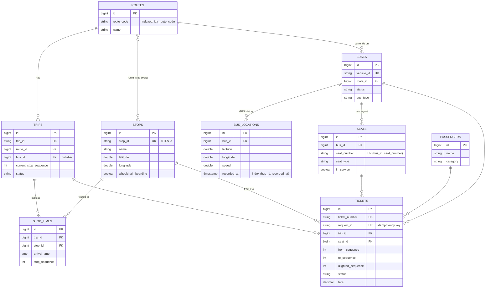

### Q4.2 Why is there no "booked" column on the seat table?

**Easy answer:** A seat's state depends on which part of the route you ask about. A seat can be taken from stop A to C and be free from C to F. So availability is calculated from tickets, not stored on the seat.

**Detailed answer:** A ticket holds its seat over the **half-open interval `[fromSequence, toSequence)`**. Two tickets on the same seat conflict only if their intervals overlap:

```
overlap(a, b)  ⇔  a.from < b.to  AND  b.from < a.to
```

```mermaid
gantt
    title Seat 07 on one trip (stop sequence on the x-axis)
    dateFormat X
    axisFormat %s
    section Seat 07
    Ticket 1 (stops 1 to 4) :done, 1, 4
    Ticket 2 (stops 4 to 9) :active, 4, 9
    Requested 3 to 6: conflict :crit, 3, 6
```

Ticket 1 frees the seat at stop 4, so ticket 2 starting at stop 4 is fine (half-open). A request for stops 3–6 overlaps both. Storing sequence numbers copied from `stop_times` makes the check a pure integer comparison. A stored flag would be wrong for every segment except one and would need updating at every stop. Bonus: `Ticket.occupiedUntilSequence()` uses `alightedSequence` when a passenger leaves early, so the seat is freed from where they actually got off.

### Q4.3 What indexes did you add and why?

**Easy answer:** An index on `routes.route_code`, because every live bus looks up its route by code, and a composite index on `bus_locations(bus_id, recorded_at)` for "this bus's history, newest first". Unique constraints act as indexes too: `vehicle_id`, `stop_id`, `trip_id`, `ticket_number`, `request_id` and `(bus_id, seat_number)`.

**Detailed answer:** Without `idx_route_code`, each of hundreds of events per poll scanned the whole routes table. The code comment in `Route.java` says exactly this. A composite index `(bus_id, recorded_at)` serves `WHERE bus_id = ? ORDER BY recorded_at DESC LIMIT 500` as an index range scan with no sort. Column order matters: equality column first, range/sort column second (the "leftmost prefix" rule). `tickets(trip_id, seat_id)` serves the seat-availability lookup. On top of that, `BusLocationIngestService.routeByCode` caches route lookups in a `ConcurrentHashMap` for 5 minutes to avoid even the indexed query.

### Q4.4 The `bus_locations` table grows by hundreds of thousands of rows a day. How do you manage it?

**Easy answer:** A scheduled job deletes rows older than 24 hours every hour, in batches of 50,000, so one delete never holds a long transaction or lock.

**Detailed answer (`BusLocationRetentionService`):**

```sql
-- repeated until it deletes 0 rows
DELETE FROM bus_locations
WHERE id < :minId + 50000        -- bounded by primary key = small, index-driven batch
  AND recorded_at < :cutoff;
```

Batching by ID range keeps each transaction short, limits WAL and replication lag, and avoids lock escalation. Better at scale: **range-partition by day** (`PARTITION BY RANGE (recorded_at)`) and `DROP` the old partition. That's instant, with no table bloat and no vacuum. Or use TimescaleDB with a retention policy. Retention is configurable (`BUS_HISTORY_RETENTION_HOURS`, `0` = keep everything).

### Q4.5 SQL vs. NoSQL: why Postgres here?

**Easy answer:** The ticketing data is relational and needs transactions: a ticket references a trip, seat, passenger and stops, and selling one must be atomic and locked. That's a textbook fit for a relational database. The one non-relational need (latest position) went to Redis.

**Detailed answer:** Use the needs → choice framing: **ACID + joins + constraints** → Postgres; **hot key/value, TTL, overwrite** → Redis; **time-series append** → Postgres partitions or TimescaleDB; **geo queries** → PostGIS (`ST_DWithin` with a GiST index) or Redis `GEOSEARCH`. I didn't need PostGIS because nearest-stop search runs on the in-memory grid.

### Q4.6 What is the N+1 problem and how did you avoid it?

**Easy answer:** N+1 means loading a list with one query, then running one more query per item to load a relation. I avoid it with `JOIN FETCH` queries for lists that need the relation.

**Detailed answer:** Relations are `FetchType.LAZY`. `BusRepository` has `SELECT b FROM Bus b LEFT JOIN FETCH b.route`, and `RouteRepository` has `SELECT DISTINCT r FROM Route r LEFT JOIN FETCH r.stops`. That's one query instead of 1 + N. `DISTINCT` removes the duplicate parent rows a collection join produces. Other tools: `@EntityGraph`, `@BatchSize`, or DTO projections.

### Q4.7 `ddl-auto=update`: is that OK for production?

**Easy answer:** It's fine for a demo, but in real production I'd use Flyway or Liquibase migrations, because `update` can't rename or drop columns, can't backfill data, and isn't reviewable.

**Detailed answer:** You can point to evidence in the code: `Bus.cameraInstalled` and `Trip.wheelchairAccessible` are boxed `Boolean` precisely because `update` adds new columns as NULL on existing rows without a backfill. With Flyway each change is a versioned SQL file (`V7__add_camera_installed.sql`) that includes `DEFAULT false` and a backfill, and it is reviewed in a PR. Production would then use `ddl-auto=validate`.

### Q4.8 Explain transaction isolation and which one you rely on.

**Easy answer:** Postgres defaults to READ COMMITTED. For ticket sales, that isn't enough on its own, so I take an explicit row lock (`SELECT ... FOR UPDATE`) on the trip so concurrent sales run one at a time per bus.

**Detailed answer:** The isolation levels are:

- **READ UNCOMMITTED:** dirty reads allowed (Postgres treats it as READ COMMITTED).
- **READ COMMITTED:** each statement sees committed data. Two sellers can both see seat 7 as free, which is a write skew.
- **REPEATABLE READ:** one snapshot per transaction, but write skew is still possible.
- **SERIALIZABLE:** full safety, but you must retry on serialization failures.

I chose READ COMMITTED plus a **pessimistic lock on one parent row** (the trip). It's simpler than SERIALIZABLE retries, and contention is naturally tiny because only one conductor sells on a given bus. See section 6.

---

## 5. Backend (Java / Spring Boot) questions

### Q5.1 How is the backend organised?

**Easy answer:** In layers: controllers take HTTP requests and validate them, services hold business logic, repositories talk to the database, and DTOs shape the JSON. The live transit engine is its own package, `live/`.

**Detailed answer:**

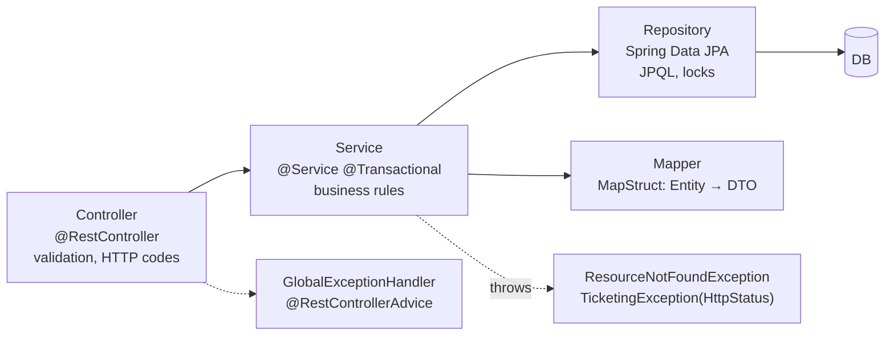

Packages: `controller`, `service`, `repository`, `entity`, `dto`, `mapper` (MapStruct), `config`, `security`, `exception`, `util`, and `live` (transit engine: `TransitIndex`, `RealtimeSnapshot`, `RouteLearner`, `StandService` ...). Lombok cuts boilerplate (`@RequiredArgsConstructor` for constructor injection).

### Q5.2 Why constructor injection?

**Easy answer:** Dependencies can be `final`, the class can't exist half-built, and tests can call `new Service(mockA, mockB)` without Spring.

**Detailed answer:** Tests use this. `BusLocationRetentionService` and `LoginAttemptLimiter` have a package-private constructor that takes a `Clock`, so tests can control time. Field injection (`@Autowired` on a field) hides dependencies and needs reflection.

### Q5.3 How does `@Scheduled` work, and what's the difference between `fixedRate` and `fixedDelay`?

**Easy answer:** `fixedDelay` waits N ms **after the previous run finishes**. `fixedRate` starts every N ms regardless. I use `fixedDelay` so a slow poll never overlaps the next one.

**Detailed answer:** `@Scheduled(fixedDelayString = "${dtc.poll.interval:4000}")` makes the interval configurable. The default scheduler is a single thread, so a slow publish would block polling. That's why `DtcIngestionService` hands publishing to its own single-thread executor and uses an `AtomicBoolean publishing` with `compareAndSet(false, true)`. If the previous batch is still writing, the new batch is **dropped**, because the next poll carries newer positions anyway. That's load shedding.

### Q5.4 How do you handle errors in the API?

**Easy answer:** A single `@RestControllerAdvice` (`GlobalExceptionHandler`) turns exceptions into consistent JSON with the right status code: 404 for not found, 409 for conflicts like a taken seat, 400 for bad input, and 403 for a forbidden seat category.

**Detailed answer:** `TicketingException` carries its own `HttpStatus` (`conflict()`, `badRequest()`), so services express intent without knowing about HTTP details. Messages are written for the user: "Seat 07 is already occupied from Rohini to Azadpur. Choose another seat, or a segment starting at Azadpur or later." Unknown errors return a generic 500 without stack traces. There's a unit test for it (`GlobalExceptionHandlerTest`).

### Q5.5 What are Spring profiles and how do you use them?

**Easy answer:** Profiles switch configuration and beans per environment. `demo` uses H2 and in-memory storage with no infrastructure. `local`/`dev` use local Postgres and Redis. `prod` reads everything from environment variables and refuses to start with weak secrets.

**Detailed answer:** `@Profile("!demo")` on `RedisBusLocationStore` means "use Redis everywhere except demo". `application-prod.properties` has no fallbacks: `jwt.secret=${JWT_SECRET}` fails fast if missing, and `ProductionSafetyCheck` rejects a short JWT secret, the default admin password, or a wildcard CORS origin. That's fail-fast configuration.

### Q5.6 How does the Spring `@Transactional` proxy work, and what's a common pitfall?

**Easy answer:** Spring wraps the bean in a proxy that opens a transaction before the method and commits or rolls back after it. The classic pitfall is that calling a `@Transactional` method from **inside the same class** skips the proxy, so there's no transaction.

**Detailed answer:** Other pitfalls: by default it rolls back only on unchecked exceptions; it only works on public methods; `readOnly = true` lets Hibernate skip dirty checking (used in `ticketsForBus`, `seatMap`). In `TicketService.complete()` the code never calls `save()`. It modifies a managed entity, and Hibernate's **dirty checking** writes the UPDATE at commit.

### Q5.7 Why Java 21? Which modern features do you use?

**Easy answer:** It's the current LTS. I use records for immutable data (`TransitIndex.Stop`, `RealtimeSnapshot.Vehicle`), switch expressions, and pattern matching.

**Detailed answer:** `Ticket.occupiedUntilSequence()` is a switch expression over an enum, and it's exhaustive, so the compiler catches a new status. Records give `equals`, `hashCode` and `toString` for free and are naturally thread-safe as immutable values. Virtual threads (Java 21) would be a good fit for the many blocking HTTP calls to OpenRouteService, which is a nice "what would you do next" point.

### Q5.8 How do you parse the GTFS-Realtime feed?

**Easy answer:** It's a Protocol Buffers binary. I use Google's `gtfs-realtime-bindings` library: `FeedMessage.parseFrom(bytes)` gives typed objects for vehicles and trip updates.

**Detailed answer:** Protobuf is compact (about 600 KB for all of Delhi), schema-based, and fast to parse. Compared with JSON: smaller and faster, but not human-readable and needs a schema. `InvalidProtocolBufferException` is caught and reported as "malformed feed". Static GTFS is CSV in a ZIP, read by a streaming row reader (`TransitIndex.Row`), not loaded whole.

---

## 6. Concurrency and ticketing questions

### Q6.1 Two conductors sell the same seat at the same moment. What happens?

**Easy answer:** Each sale locks the trip row with `SELECT ... FOR UPDATE` before checking seats. The second sale waits until the first commits, then sees the seat taken and gets a 409 Conflict.

**Detailed answer:**

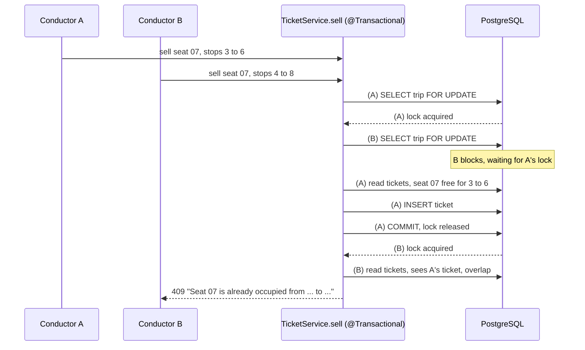

Code: `TripRepository.lockById` uses `@Lock(LockModeType.PESSIMISTIC_WRITE)`. Every write path (`sell`, `complete`, `cancel`, `advance`) goes through `TicketingJourneyLoader.loadForUpdate`, so all of them are serialised per trip.

### Q6.2 Why pessimistic and not optimistic locking?

**Easy answer:** Optimistic locking (`@Version`) detects a conflict at commit and makes you retry. Here the thing being protected is a **set of tickets**, not one row being updated, so there's no single version to check. Locking the parent trip row is the simplest correct way.

**Detailed answer:**

| | Optimistic (`@Version`) | Pessimistic (`FOR UPDATE`) |
|---|---|---|
| Mechanism | Version check at UPDATE | Row lock at read |
| Best when | Conflicts rare, single-row updates | Conflicts likely, or invariant spans many rows |
| Cost | Retry on conflict | Waiting; deadlock risk if locks are taken in different orders |
| Fits the "no overlapping tickets" invariant? | No: inserts don't touch a shared version | Yes: lock the parent (trip) |

Alternatives you can mention: a Postgres **exclusion constraint** with `int4range` and a GiST index (`EXCLUDE USING gist (seat_id WITH =, int4range(from_seq, to_seq) WITH &&)`), which enforces "no overlapping ranges" in the database itself; SERIALIZABLE isolation with a retry; or a Redis distributed lock (overkill here). Deadlock risk is low because every path locks exactly one row, the trip.

### Q6.3 The conductor double-taps "Sell" on a slow network. How do you prevent two tickets?

**Easy answer:** With an **idempotency key**. The client generates a `requestId` for each sale, it's stored with a UNIQUE constraint, and a repeated request is rejected instead of issuing a second ticket.

**Detailed answer:** `TicketService.sell` checks `requestId` twice: once before taking the lock (cheap fast path) and **again after** acquiring the trip lock, because a concurrent duplicate may have committed while we waited. The UNIQUE constraint on `tickets.request_id` is the final guarantee even if both checks were somehow passed. This is the same pattern as Stripe's `Idempotency-Key` header. An improvement: return the **original ticket** (200) instead of 409, so the client can safely retry and get the same result.

### Q6.4 Draw the ticket lifecycle.

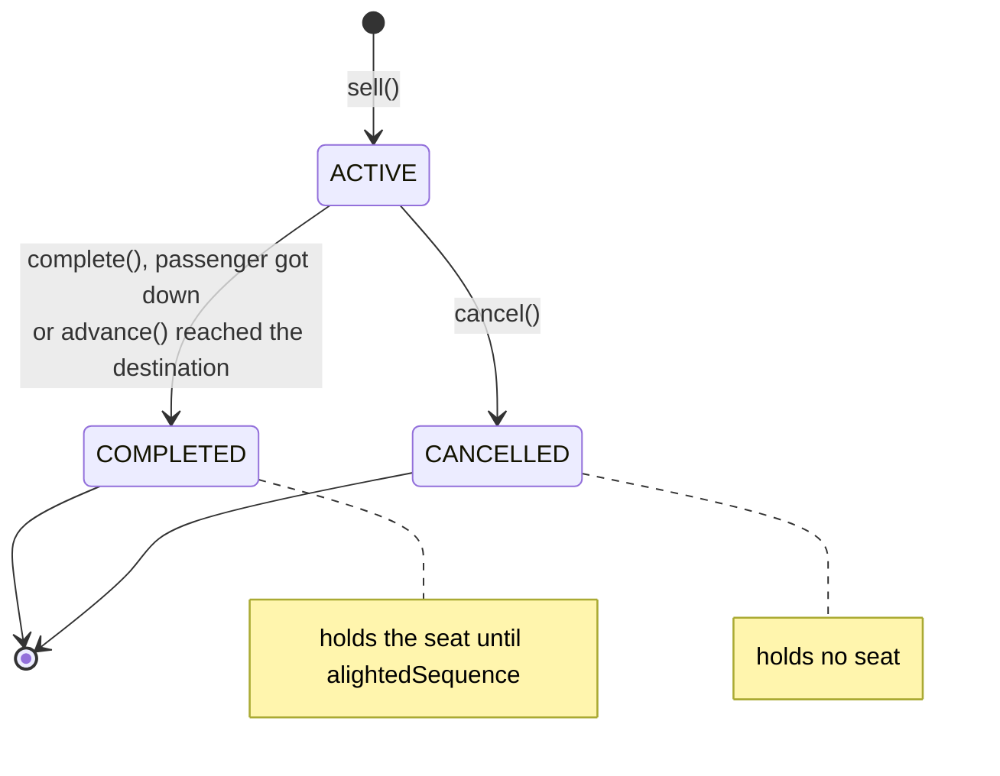

Guards: you can't complete a cancelled ticket; you can't complete before the passenger has travelled (then you cancel instead); you can't alight beyond the ticket's destination. Each guard gives a clear 409 or 400 message.

### Q6.5 Where else did you deal with thread safety?

**Easy answer:** The live snapshot is replaced, never modified: a `volatile` reference is swapped to a new immutable map, so readers never see a half-updated state and need no locks.

**Detailed answer:**

- `RealtimeSnapshot`: `private volatile Map<String, Vehicle> vehicles`. Each poll builds a new map and assigns it once. This is **copy-on-write** or **immutable snapshot publication**. `volatile` guarantees visibility to other threads.
- A `generation` counter increments on every update; caches compare generations to know when to rebuild.
- `CopyOnWriteArrayList` for listeners (rarely written, often iterated).
- `ConcurrentHashMap` + `compute()` in `LoginAttemptLimiter` for atomic per-key updates.
- `AtomicBoolean.compareAndSet` to allow only one publish at a time.
- `DtcApiClient.fetchVehiclePositions()` is `synchronized` because the ETag field is shared state.
- `RegionalBusesCache` stores `CompletableFuture`s in a `ConcurrentHashMap`, so **concurrent requests for the same new snapshot share one build** (protects against a cache stampede).

---

## 7. Real-time (WebSocket / polling) questions

### Q7.1 How does the WebSocket part work?

**Easy answer:** The browser connects to `/ws` using SockJS, which falls back to HTTP if WebSockets are blocked, and speaks STOMP, a simple pub/sub protocol. It subscribes to `/topic/buses`. Each time the server ingests a position, it calls `messagingTemplate.convertAndSend("/topic/buses", event)`.

**Detailed answer:**

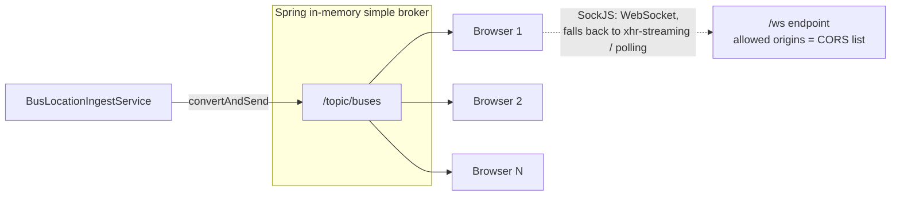

`WebSocketConfig`: `enableSimpleBroker("/topic")`, application prefix `/app`, endpoint `/ws` with `setAllowedOrigins` (same origins as CORS, never `*`).

### Q7.2 Hundreds of messages arrive per poll. How does the browser avoid lagging?

**Easy answer:** Messages are buffered in a plain object keyed by vehicle ID, and React state updates once every 250 ms. That's one re-render per batch instead of hundreds, and newer positions overwrite older ones in the buffer.

**Detailed answer:** In `useBusSocket`, `pending[event.vehicleId] = event; if (!timer) timer = setTimeout(flush, 250)`. This is **coalescing/throttling**. On the map side, markers are reused and moved with `setLatLng` rather than recreated. My benchmark cut Leaflet calls per update from about 3,900 to about 990, and `.on()` handler registrations from 3,920 to 34.

### Q7.3 What if the connection drops?

**Easy answer:** The STOMP client reconnects automatically every 4 seconds, and the UI shows a "reconnecting" status. Polling screens retry with exponential backoff and keep showing the last good data.

**Detailed answer:** `status` moves through `connecting → connected → reconnecting`. A `disposed` flag stops a replaced client's close event from marking the new one as down (a race-condition fix). `usePolling`: on failure it doubles the delay up to `maxBackoff` (60 s), pauses when the tab is hidden (`document.hidden`), refreshes immediately when the tab comes back or the browser goes online, and uses `AbortController` to cancel stale requests so an old response never overwrites a newer selection.

### Q7.4 How would you scale WebSockets across multiple servers?

**Easy answer:** Replace the in-memory broker with an external one (RabbitMQ through `enableStompBrokerRelay`, or Redis Pub/Sub), so every server receives every published event and forwards it to its own connected clients. Use sticky sessions or plain WebSockets at the load balancer.

**Detailed answer:** Also, **reduce fan-out**: per-route or per-map-tile topics, so a phone looking at one route doesn't receive 7,000 buses. Send deltas, not full objects. Consider a dedicated WebSocket gateway tier, since connection count limits differ from CPU limits.

---

## 8. Caching and performance questions

### Q8.1 What was your biggest performance win?

**Easy answer:** Caching the main map response per feed snapshot. Before, every request rebuilt a 750 KB JSON answer. After, it's built once per snapshot, pre-compressed with gzip, and shared. p50 latency went from 375 ms to 44 ms, and with 20 concurrent clients, p50 went from 2.9 s to 154 ms.

**Detailed answer (`RegionalBusesCache`):**

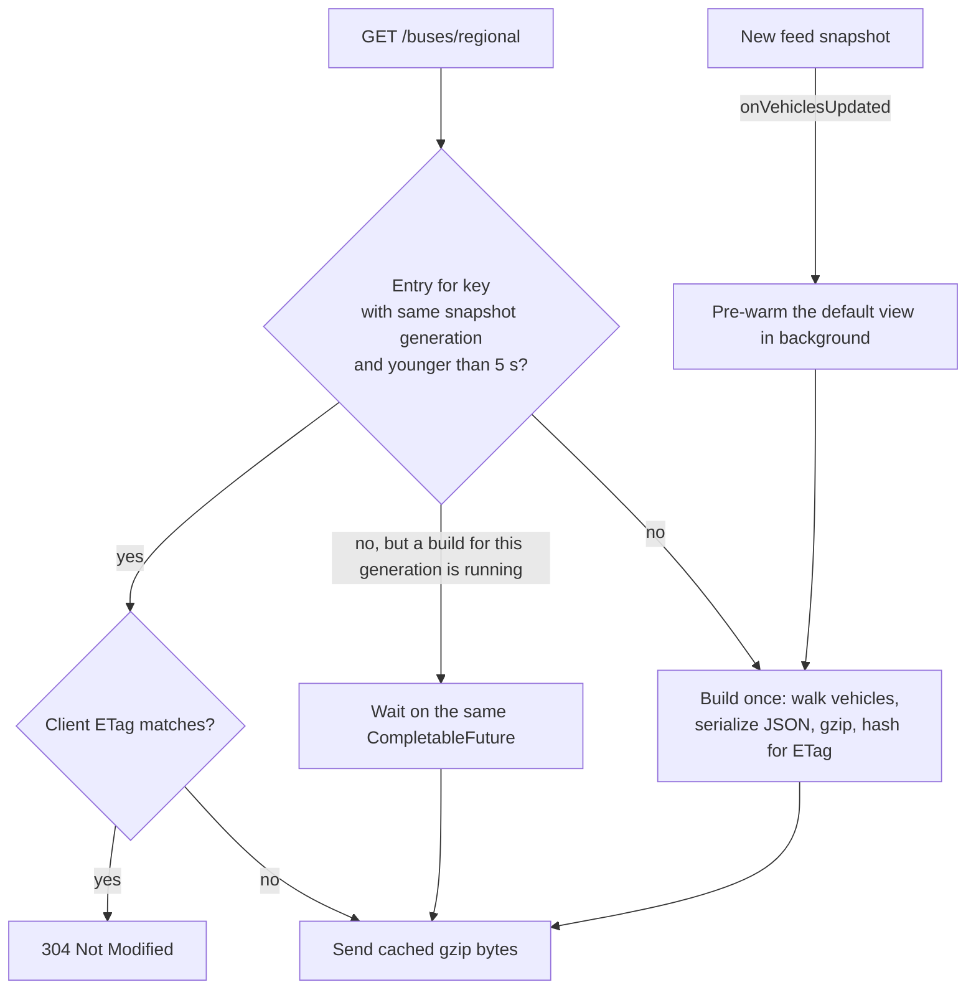

| Metric | Before | After |
|---|---|---|
| p50 / p95 (1 client) | 375 / 676 ms | 44 / 466 ms |
| p50 (20 clients every 2 s) | 2,941 ms | 154 ms |
| Requests completed in 60 s (600 intended) | 266 | 540 |
| Bytes per poll | 692 KB | 62 KB (gzip) |

Techniques: **cache keyed by data version** (snapshot generation), **request coalescing** (shared future), **stale-while-revalidate** (an old entry is served once while a background rebuild runs), **pre-warming**, **pre-compression**, **ETag/304**, and a **bounded cache** (max 256 keys, since route numbers are user input).

### Q8.2 Explain ETags and how you used them in two places.

**Easy answer:** An ETag is a fingerprint of a response. The client sends it back in `If-None-Match`, and if nothing changed the server replies `304 Not Modified` with no body. I use it **as a client** when polling Delhi's feed and **as a server** for my own map endpoint.

**Detailed answer:** Delhi's feed changes about every 11 s. Polling every 4 s with ETags gets new positions about 3 s sooner on average, while still downloading the 600 KB body only when it changed. On my side, the ETag is a content hash of the cached answer, so clients that already have it pay almost nothing.

### Q8.3 What other caches exist and how are they invalidated?

**Easy answer:** A route-code-to-route map (5-minute TTL), stand arrivals (5 s, per snapshot), stand-pair route searches (static, so cached indefinitely), walking directions (30 s in memory), and the tracked-route set (5 minutes).

**Detailed answer:** "There are only two hard things in computer science: cache invalidation and naming things." My rule: **cache keyed by data version** where possible (snapshot generation), so invalidation is automatic; **TTL** where the source has no version (DB route mapping); and **never cache** user-specific data. External calls (OpenRouteService) also get timeouts and a **failure cooldown**, a simple circuit breaker.

### Q8.4 The server kept getting OOM-killed on Render. How did you fix it?

**Easy answer:** The JVM's heap setting didn't leave room for non-heap memory in a 512 MB container. I set heap to 40% of container RAM, capped metaspace and code cache, used SerialGC, and made the JVM exit on OOM so the platform restarts a clean process.

**Detailed answer:** From the Dockerfile: `-XX:MaxRAMPercentage=40 -XX:MaxMetaspaceSize=150m -XX:ReservedCodeCacheSize=40m -XX:TieredStopAtLevel=1 -Xss512k -XX:MaxDirectMemorySize=32m -XX:+UseSerialGC -XX:+ExitOnOutOfMemoryError`. 55% heap got the container killed: the process RSS is heap + metaspace + code cache + thread stacks + direct buffers. Packed arrays in `TransitIndex` also cut retained heap by 13 MB. **Lesson to say:** container memory ≠ JVM heap.

### Q8.5 How did you measure performance?

**Easy answer:** I wrote scripts in `perf/`: a load generator for latency percentiles with N clients, a probe for feed freshness, and a Playwright benchmark that replays recorded responses into the production build to count map operations and main-thread time.

**Detailed answer:** Report **percentiles (p50/p95/p99), not averages**, because tail latency is what users feel. Measure before and after on the same machine with the same recorded data, so the comparison is fair. JFR (Java Flight Recorder) samples showed the publish thread went from 857 to 192 samples per minute.

---

## 9. Security questions

### Q9.1 How does authentication work?

**Easy answer:** Riders don't log in. Only admin and conductor endpoints need auth. The admin logs in with username and password (BCrypt-hashed), receives a signed JWT, and sends it as `Authorization: Bearer <token>`. A filter verifies the signature on every request.

**Detailed answer:**

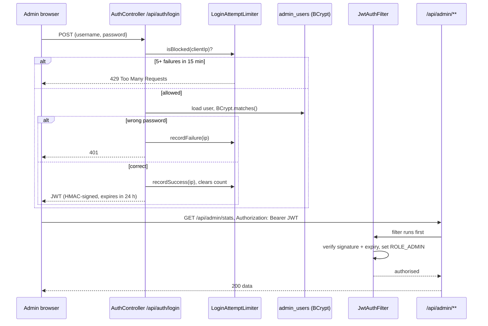

`SecurityConfig`: stateless sessions, `/api/admin/**` and `/api/conductor/**` need `ROLE_ADMIN`, and everything else is `permitAll()`.

### Q9.2 Why is CSRF disabled? Isn't that dangerous?

**Easy answer:** CSRF attacks rely on the browser **automatically** sending cookies. My API uses a bearer token in a header that JavaScript adds explicitly, and a malicious site can't make the browser add it. So CSRF protection isn't needed for this stateless API.

**Detailed answer:** If I switched to storing the JWT in an HttpOnly cookie (safer against XSS stealing it), I would **have to** re-enable CSRF protection or use `SameSite=Strict`. That trade-off is localStorage + header (XSS risk) vs. cookie (CSRF risk).

### Q9.3 What are the weaknesses of your JWT setup?

**Easy answer:** A JWT can't be revoked before it expires, and mine lasts 24 hours. There's no refresh token and only one role.

**Detailed answer:** Improvements: short-lived access tokens (15 min) + a refresh token stored server-side (revocable); a token denylist in Redis keyed by `jti` for logout; separate `CONDUCTOR` and `ADMIN` roles (least privilege; today conductors use the admin login); key rotation with a `kid` header. Strengths to mention: secret is at least 32 bytes and enforced in prod; HMAC signature; expiry checked.

### Q9.4 What other security measures did you add?

**Easy answer:** Brute-force protection on login, strict CORS, fail-fast production secrets, non-root Docker user, only health/info actuator endpoints exposed in production, Swagger off in production, and the API key kept out of logs and the browser.

**Detailed answer:**

- **Rate limiting:** `LoginAttemptLimiter`, 5 failures → 15-minute lockout per IP, with at most 10,000 tracked IPs so a flood can't exhaust memory.
- **Real client IP:** `server.forward-headers-strategy=native` trusts `X-Forwarded-For` only from the platform proxy, so attackers can't spoof their IP to dodge the limiter.
- **Input validation:** coordinates must be finite and inside Delhi/NCR (`RequestBounds`); limits are capped (`limit` max 30, `walkMeters` 0–500).
- **Secrets:** `ORS_API_KEY` is used server-side only and never sent to React. Error messages never include the feed URL (it has the key in a query parameter).
- **Supply chain:** CodeQL scanning and Dependabot.
- **Container:** runs as `USER app`, not root.

---

## 10. Algorithms and geospatial questions

### Q10.1 How do you find the nearest bus stops quickly?

**Easy answer:** A **spatial grid**. Stops are bucketed into cells of 0.01° (about 1.1 km). For a query, I only look at the few cells around the user, compute exact distances there, and sort.

**Detailed answer:**

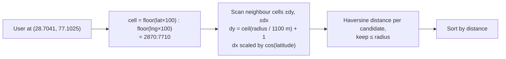

That's O(stops in nearby cells) instead of O(all stops), which is a few hundred instead of thousands. `dx` is wider than `dy` because a degree of longitude shrinks with `cos(latitude)`. Alternatives: **geohash**, **quadtree / R-tree**, **PostGIS GiST index**, **Redis `GEOSEARCH`**, **H3 hexagons** (Uber).

### Q10.2 What is the Haversine formula?

**Easy answer:** It gives the great-circle distance between two latitude/longitude points on a sphere: the "as the crow flies" distance on Earth.

**Detailed answer:**

```
a = sin²(Δφ/2) + cos φ1 · cos φ2 · sin²(Δλ/2)
d = 2R · atan2(√a, √(1−a))      R ≈ 6,371 km
```

Used in `GeoUtils.haversine`. For tiny distances an equirectangular approximation is faster and accurate enough. For walking ETA, straight-line distance is only a **lower bound**. The nearest-stop search uses it to prune candidates before calling the real walking API (at most 8 calls; it stops when the next lower bound can't beat the best real route). That's a **branch-and-bound** idea.

### Q10.3 How does `RouteLearner` work?

**Easy answer:** For each route, it records the GPS trail of a bus driving it, cleans out jitter and glitches, and keeps the longest clean recording as the "real route". Stops within 40 m of that path are the route's real stops, and the recorded timestamps give travel times between them.

**Detailed answer:**

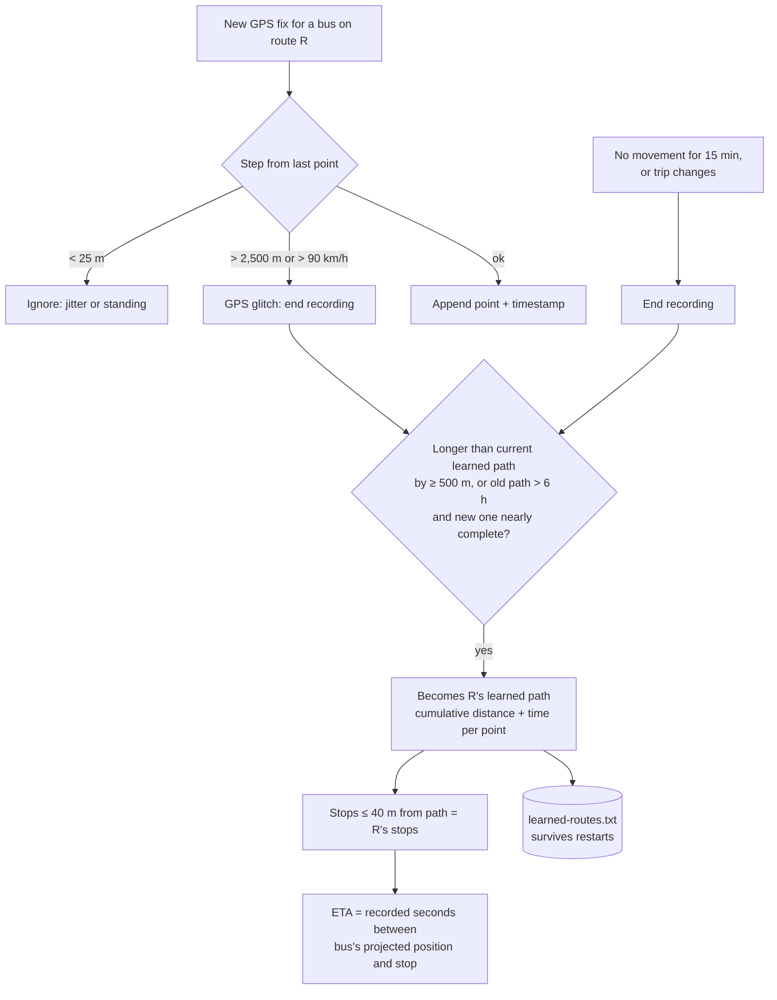

Thresholds are named constants: `MIN_STEP_METERS = 25`, `MAX_STEP_METERS = 2500`, `MAX_SPEED_KMH = 90`, `MAX_SILENCE_SECONDS = 900`, `STOP_ON_PATH_METERS = 40`, `MIN_GROWTH_METERS = 500` (hysteresis, so stops aren't re-matched every poll). Privacy: only learned paths are kept; raw GPS traces are discarded once a recording ends.

### Q10.4 How do you know where a bus is "along" its route?

**Easy answer:** I project the GPS point onto the route polyline, finding the closest point on the closest segment, and add up the length of all segments before it. The result is "metres along the route", so the distance to a stop is just `stopAlong − busAlong`.

**Detailed answer:** For each segment AB and point P: `t = clamp(((P−A)·(B−A)) / |B−A|², 0, 1)`, closest point `A + t(B−A)`. Keep the segment with the smallest offset. Reject if offset > 100–150 m (bus not on this route). For routes that loop past the same place twice, use the bearing and the previous position to pick the right occurrence; if it's still ambiguous, don't give an ETA. This is also called **map matching** (production systems use Hidden Markov Models, for example OSRM's map matching).

### Q10.5 How does stand name matching work?

**Easy answer:** Normalise names (lowercase, strip punctuation, unify abbreviations like "Sec"/"Sector"), then merge same-name stops within 300 m into one stand. Search matches every query word as a word prefix, so "rohini sec" finds "Rohini Sector 21".

**Detailed answer:** Merging is **transitive chaining** within 300 m (like connected components or union-find). `/`-separated parts are compared in any order. Ranking: best text match, then busier stands. Two different stands with the same name get a "near …" hint for disambiguation.

---

## 11. Frontend questions

### Q11.1 How is the frontend structured?

**Easy answer:** React 19 with Vite. Pages in `pages/`, reusable UI in `components/`, data-fetching logic in custom hooks (`usePolling`, `useBusSocket`, `useUserLocation`), small client stores (`store/`) for favourites, theme and watches persisted in localStorage, and Leaflet for maps.

**Detailed answer:** Custom hooks keep pages declarative: `const { data, error, loading } = usePolling(key, fetcher, { interval })`. API calls go through `api/client.js` with typed errors (`api/errors.js`). An `ErrorBoundary` stops one broken widget from crashing the app. The admin console is split into sections with a command palette.

### Q11.2 How do you avoid race conditions in the frontend?

**Easy answer:** Each request gets an `AbortController`. When the user changes the selected stop, the old request is cancelled, so its late response can't overwrite the new one. Polling waits for the previous request to finish before scheduling the next, so requests never overlap.

**Detailed answer:** `usePolling` uses `inFlight` guards, `disposed` flags for unmount, `key` changes reset state, and `nextDelay` aligns polling with the server's `X-Next-Update-In`. These patterns are the same thing as libraries like React Query or SWR, implemented by hand.

### Q11.3 How does geolocation and walking navigation work?

**Easy answer:** The browser's `watchPosition` API starts only when the user clicks, which respects privacy. The backend fetches a walking route from OpenRouteService. The app shows remaining distance locally and re-routes if you stray too far, at most every 30 seconds.

**Detailed answer:** Directions pause when GPS accuracy is poor (> 50 m). Deviation threshold = max(35 m, 2 × accuracy). The watch is cleared on stop and on unmount. GPS is never stored on the server. Geolocation needs HTTPS or localhost.

---

## 12. DevOps, deployment and testing questions

### Q12.1 How is it deployed?

**Easy answer:** On Render, defined as code in `render.yaml`: a Docker web service for the API, a static site for the React build, managed Postgres and managed Redis. Locally, `docker compose up` runs the same four pieces.

**Detailed answer:**

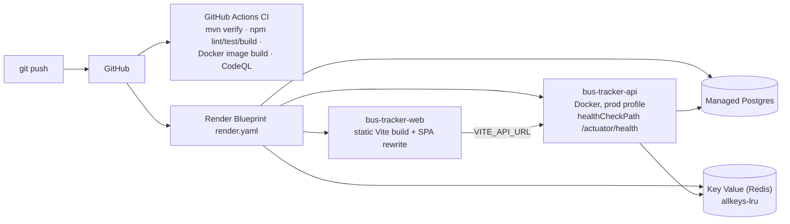

Secrets: `JWT_SECRET` and `ADMIN_PASSWORD` are generated by Render (`generateValue: true`); the API key and CORS origin are set by hand (`sync: false`). The SPA rewrite `/* → /index.html` makes deep links like `/route/123` work with client-side routing.

### Q12.2 Explain your Dockerfile.

**Easy answer:** It's a multi-stage build. Stage 1 uses a Maven image to compile the jar; stage 2 copies only the jar into a small JRE image and runs it as a non-root user. Dependencies are downloaded in their own layer so code-only changes rebuild fast.

**Detailed answer:** `COPY pom.xml` → `mvn dependency:go-offline` → `COPY src` is the layer-caching trick. A guard fails the build if `GTFS.zip` is a Git LFS pointer (smaller than 1 MB) instead of the real file, which turns a confusing runtime crash into a clear build error. JVM flags are sized for a 512 MB container (Q8.4).

### Q12.3 How do you test it?

**Easy answer:** JUnit tests for services (ticketing, ETA, route learning, stand search, login limiter, retention, error handler) plus a Spring context test; Vitest and ESLint for the frontend; Playwright browser tests; all run in CI on every push and PR.

**Detailed answer:** Testability choices: an injectable `Clock` (time-dependent logic like lockout windows and retention is tested without `sleep`); package-private constructors for tests; a demo profile with H2 so the context test doesn't need Postgres; Mockito for repositories. CI doesn't fetch Git LFS, because no test needs the 55 MB GTFS file and that saves LFS bandwidth. Test pyramid: many unit tests, a few integration tests, very few end-to-end.

### Q12.4 How do you monitor it in production?

**Easy answer:** Spring Actuator health checks (with liveness and readiness probes) that Render uses to restart unhealthy instances, an admin feed-health page with the last successful poll and the last error, and a learning-status endpoint.

**Detailed answer:** Improvements: structured logging with SLF4J instead of `System.out` (the ingestion service still has some), Micrometer metrics exported to Prometheus/Grafana (poll latency, feed age, publish backlog, cache hit rate), alerts when feed age exceeds 60 s, and distributed tracing with OpenTelemetry.

---

## 13. Weaknesses and "what would you improve?"

Interviewers love this question. Being honest about trade-offs is a strength. Pick 3–4.

| Weakness (honest) | Why it's there | Improvement |
|---|---|---|
| `RedisBusLocationStore.findAll()` uses `KEYS bus:*` | Simple; fine for a few thousand keys | `KEYS` is O(N) and blocks Redis. Use one hash (`HSET`/`HGETALL`), `SCAN`, or a `GEO` set |
| In-memory STOMP broker, limiter, scheduler | Single instance on the free tier | Broker relay / Redis Pub/Sub, Redis rate limiter, ShedLock |
| One `bus_locations` INSERT per event | Simple | Batch inserts (`saveAll` + `hibernate.jdbc.batch_size`), or `COPY`; partition by day |
| `ddl-auto=update` | Fast iteration | Flyway migrations + `validate` |
| JWT 24 h, no revocation, single role | Demo admin | Short access + refresh tokens, `CONDUCTOR` role |
| `System.out.println` logging in ingestion | Legacy code | SLF4J + structured JSON logs |
| Learned routes in a local file | Free tier has no DB writes for it | Store in Postgres; currently lost on Render redeploys |
| Ingestion drops a batch when busy | Deliberate load shedding | Fine; document it and track a metric |
| Static GTFS from 2024 | No newer official feed | `RouteLearner` compensates; swap feed with `GTFS_RESOURCE` |
| One-transfer route search only | Scope | RAPTOR for multi-transfer |

**Easy summary answer:** "It's built for a single instance on a free tier, so a few pieces are in-process: the WebSocket broker, rate limiter and scheduler. To go multi-instance, I'd move those to Redis or RabbitMQ, replace the Redis `KEYS` scan with a hash, add Flyway, and partition the history table."

---

## 14. Behavioural questions about the project

Use the **STAR** format: Situation, Task, Action, Result.

**"Tell me about the hardest bug or challenge."**
- **S:** Arrival times were wrong or missing for most routes.
- **T:** Find out why.
- **A:** I inspected the bundled GTFS directly. It was from June 2024 and had no `shapes.txt`; `route_short_name` was empty for all 2,403 routes; and live buses were kilometres from their listed stops. So I built `RouteLearner` to learn real routes from GPS, with thresholds to reject jitter and glitches, persisted to a file.
- **R:** After 1–2 hours of learning, routes have arrival times based on real recorded travel times.

**"Tell me about a performance problem you solved."**
- **S:** With 20 users the map endpoint's p95 was 11 s.
- **T:** Make it scale on a 512 MB free instance.
- **A:** I profiled it and found every request rebuilt and serialised a 750 KB answer. I added a per-snapshot cache with request coalescing, pre-gzip, ETags and pre-warming.
- **R:** p50 went from 2.9 s to 154 ms under load, wire size fell 11×, and completed requests doubled.

**"Tell me about a production incident."**
- The Render instance was OOM-killed. Diagnosis: heap at 55% of container memory plus non-heap memory exceeded 512 MB. Fix: 40% heap, capped metaspace and code cache, SerialGC, `ExitOnOutOfMemoryError`, and packed arrays in the index. Lesson: container memory ≠ heap.

**"How did you ensure correctness in ticketing?"**
- Pessimistic trip lock, half-open intervals, idempotency key with a double check under the lock, a UNIQUE constraint as the last line of defence, and unit tests for overlap edge cases.

**"Why did you make X decision?"** Always answer as: *the requirement → the options → the trade-off → what I picked → what would change my mind.*

---

## 15. Rapid-fire revision sheet

| Question | One-line answer |
|---|---|
| Poll interval? | 4 s with ETag; the feed changes about every 11 s |
| Feed format? | GTFS-Realtime protobuf (`VehiclePositions.pb`) |
| Latest position stored where? | Redis key `bus:{vehicleId}` |
| History stored where? | Postgres `bus_locations`, index `(bus_id, recorded_at)`, 24 h retention, hourly batched purge |
| Push channel? | STOMP over SockJS, `/ws`, topic `/topic/buses` |
| Browser batching? | Flush every 250 ms |
| Seat overlap rule? | Half-open `[from, to)`: overlap if `a.from < b.to && b.from < a.to` |
| Double-booking prevention? | `PESSIMISTIC_WRITE` lock on the trip row |
| Double-submit prevention? | `requestId` idempotency key + UNIQUE constraint |
| Auth? | BCrypt + JWT (HMAC, 24 h), stateless, admin/conductor only |
| Brute force? | 5 failures → 15-min lockout per IP |
| Nearest stop? | 0.01° spatial grid + Haversine |
| ETA order? | TripUpdates → learned travel times → distance ÷ speed → 17 km/h assumption |
| Stale fix? | Older than 120 s → dropped |
| Main cache? | `RegionalBusesCache`: per snapshot generation, ≤ 5 s, gzip + ETag, shared future |
| p50 improvement? | 375 → 44 ms (1 client); 2,941 → 154 ms (20 clients) |
| JVM heap? | `MaxRAMPercentage=40`, SerialGC, `ExitOnOutOfMemoryError` |
| Profiles? | `demo` (H2), `local`/`dev`, `prod` (fail-fast secrets) |
| Deploy? | Render Blueprint: Docker API + static web + Postgres + Key Value |
| CI? | GitHub Actions: `mvn verify`, `npm lint/test/build`, Docker build, CodeQL, Dependabot |
| `fixedDelay` vs `fixedRate`? | Delay waits for the previous run to finish; rate doesn't |
| Why `volatile` snapshot? | Atomic swap of an immutable map, so readers need no locks |
| CAP for this system? | Prefers availability: serve the last snapshot with a staleness warning |
| Biggest scaling blocker? | In-memory broker / limiter / scheduler, plus Redis `KEYS` |
